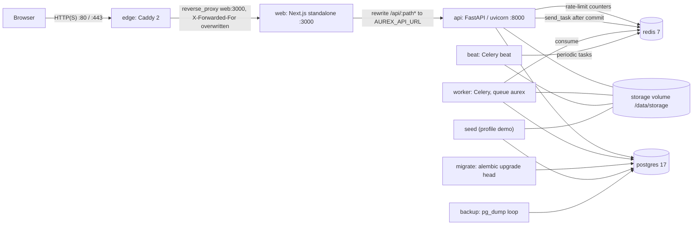
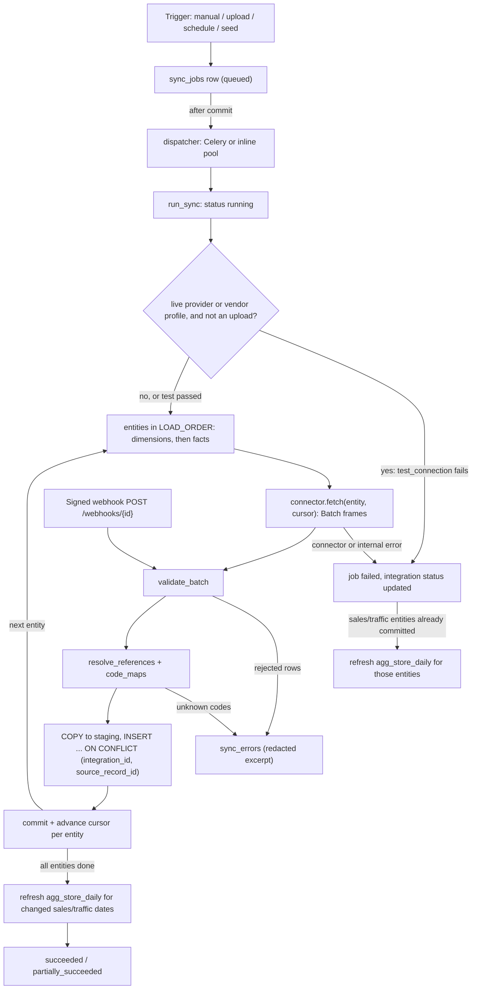

# AUREX architecture

This document describes how AUREX is put together at runtime and in code: the deployed components, the path a
request takes, the backend layering and tenancy model, background jobs, the ingestion pipeline, the error and
response conventions, and a module map. Every statement links to the code it was derived from. Companion
documents: [DATA_MODEL.md](DATA_MODEL.md), [METRICS.md](METRICS.md), [FORECASTING.md](FORECASTING.md),
[DECISION_LAB.md](DECISION_LAB.md), [ADVISOR.md](ADVISOR.md), [NOVAMART.md](NOVAMART.md); operations and
controls are covered in [DEPLOYMENT.md](DEPLOYMENT.md), [INTEGRATIONS.md](INTEGRATIONS.md), [SECURITY.md](SECURITY.md) and
[TESTING.md](TESTING.md).

## 1. Components

| Component | Code | Compose service | Role |
|---|---|---|---|
| Web | `frontend/` (Next.js 16.4.2, React 19.3, TanStack Query 5) [package.json:20](../frontend/package.json#L20) | `web` [docker-compose.yml:109](../docker-compose.yml#L109) | Marketing, sign-in and the `/app` workspace; proxies `/api/*` to the API. Built as a standalone Node server on port 3000 ([Dockerfile](../frontend/Dockerfile)). |
| API | `backend/app` (FastAPI, SQLAlchemy 2, pandas/statsmodels/scikit-learn) [pyproject.toml:6](../backend/pyproject.toml#L6) | `api` [docker-compose.yml:63](../docker-compose.yml#L63) | All authentication, authorization, analytics, forecasting, simulation and the advisor. `uvicorn app.main:app` with 2 workers ([Dockerfile:46](../backend/Dockerfile#L46)). |
| Database | PostgreSQL 17 | `postgres` [docker-compose.yml:25](../docker-compose.yml#L25) | System of record. Schema from Alembic; the `pg_trgm` extension is created by the first migration ([0001:22](../backend/migrations/versions/20261018_0001_initial_schema.py#L22)). |
| Migrations | `backend/migrations` | `migrate` [docker-compose.yml:53](../docker-compose.yml#L53) | One-shot `alembic upgrade head`; `api`, `worker`, `beat` and `seed` wait for it to complete. |
| Redis (optional) | — | `redis` [docker-compose.yml:41](../docker-compose.yml#L41) | Celery broker and shared rate-limit counters ([docker-compose.yml:44](../docker-compose.yml#L44)). |
| Worker (optional) | `backend/app/worker` | `worker` [docker-compose.yml:76](../docker-compose.yml#L76) | `celery worker -Q aurex --concurrency=2`. |
| Beat (optional) | `backend/app/worker/celery_app.py` | `beat` [docker-compose.yml:92](../docker-compose.yml#L92) | Periodic tasks (section 4). |
| Edge | `deploy/Caddyfile` | `edge` [docker-compose.yml:120](../docker-compose.yml#L120) | Caddy 2; the only service that publishes ports (80/443). Automatic HTTPS when `AUREX_SITE_ADDRESS` is a hostname. |
| Backup | `deploy/backup/` | `backup` [docker-compose.yml:135](../docker-compose.yml#L135) | Loop of `pg_dump --format=custom` plus a tar of `/data/storage`, with SHA-256 checksums and age-based retention (`BACKUP_INTERVAL_SECONDS`, `BACKUP_RETENTION_DAYS`) ([backup.sh:9-34](../deploy/backup/backup.sh#L9-L34)). |
| Demo seed | `backend/app/seed/demo.py` | `seed` (profile `demo`) [docker-compose.yml:154-157](../docker-compose.yml#L154-L157) | `python -m app.seed.demo --train`; see [NOVAMART.md](NOVAMART.md). |

Redis and Celery are optional outside docker-compose. The settings default is `task_backend = "inline"` and
`redis_url = None` ([config.py:68-69](../backend/app/core/config.py#L68-L69)); docker-compose overrides both
([docker-compose.yml:18-19](../docker-compose.yml#L18-L19)). Without Redis the rate limiter falls back to an
in-process counter, which is only correct for a single API process
([ratelimit.py:69-81](../backend/app/core/ratelimit.py#L69-L81)). Uploads, generated reports and the beat
schedule file live in a shared `storage` volume mounted at `/data/storage` (`AUREX_STORAGE_DIR`,
[storage.py](../backend/app/services/storage.py)).



## 2. Request flow

1. **Edge.** Caddy forwards every request to `web:3000`, limits request bodies to 30 MB and **overwrites**
   `X-Forwarded-For` with the client address ([Caddyfile:7-20](../deploy/Caddyfile#L7-L20)). The API trusts exactly
   one proxy hop in compose (`AUREX_TRUSTED_PROXY_HOPS=1`, [docker-compose.yml:21](../docker-compose.yml#L21)); with the
   default of 0 it ignores the header and uses the socket peer ([audit.py:16-29](../backend/app/services/audit.py#L16-L29)).
2. **Next.js.** The browser only talks to the Next.js origin. `/api/:path*` is rewritten to
   `${AUREX_API_URL}/api/:path*` ([next.config.ts:29-31](../frontend/next.config.ts#L29-L31)). `AUREX_API_URL` is read when
   the config is evaluated, i.e. baked in at `next build` ([next.config.ts:5-6](../frontend/next.config.ts#L5-L6),
   [frontend/Dockerfile](../frontend/Dockerfile)). Because the API is same-origin, no CORS is involved in the
   deployed topology; the API's CORS middleware only applies to `AUREX_CORS_ORIGINS` (default `localhost:3000`) for
   direct development access ([main.py:97-104](../backend/app/main.py#L97-L104)).
3. **`src/proxy.ts` is only an optimistic redirect.** For `/app/*` it checks that the `aurex_session` hint cookie
   exists and otherwise redirects to `/sign-in?next=...` ([proxy.ts:9-24](../frontend/src/proxy.ts#L9-L24)). It does not
   validate anything; every API call is authenticated and authorized by FastAPI.
4. **API client.** `src/lib/api.ts` sends `credentials: "same-origin"`, adds `X-CSRF-Token` (copied from the readable
   `aurex_csrf` cookie) to unsafe methods, and on a 401 performs one deduplicated `POST /auth/refresh` and retries
   ([api.ts:64-119](../frontend/src/lib/api.ts#L64-L119)). Org-scoped calls are built as `/orgs/{activeOrg}{path}`
   ([use-org-query.ts:33-43](../frontend/src/hooks/use-org-query.ts#L33-L43)); the active organization is kept in
   `localStorage["aurex.activeOrg"]` ([session-provider.tsx:33-67](../frontend/src/components/app/session-provider.tsx#L33-L67)).
   Company, store and period filters live in the URL query string ([use-filters.ts:8-13](../frontend/src/hooks/use-filters.ts#L8-L13)).
5. **FastAPI.** The `/api/v1` prefix comes from `api_prefix` ([config.py:35](../backend/app/core/config.py#L35)). A
   middleware assigns the request id, applies the per-IP limit and adds headers (section 6). Dependencies then
   authenticate the user and resolve the organization context (section 3).

### Cookies and tokens

Set by `_set_auth_cookies` ([auth.py:107-117](../backend/app/services/auth.py#L107-L117)); `Secure` and `Domain` come from
`AUREX_COOKIE_SECURE` / `AUREX_COOKIE_DOMAIN`.

| Cookie | HttpOnly | SameSite | Path | Lifetime | Content |
|---|---|---|---|---|---|
| `aurex_access` | yes | Lax | `{api_prefix}` (`/api/v1` by default, [auth.py:111](../backend/app/services/auth.py#L111)) | `access_token_ttl_minutes` (15) | HS256 JWT with `sub`, `sid`, `iat`, `nbf`, `exp`, `iss`, `aud`, `typ=access`, `jti` ([security.py:92-108](../backend/app/core/security.py#L92-L108)) |
| `aurex_refresh` | yes | Strict | `{api_prefix}/auth` (`/api/v1/auth` by default, [auth.py:113](../backend/app/services/auth.py#L113)) | `refresh_token_ttl_days` (14) | Random 48-byte token; only its HMAC-SHA256 is stored ([security.py:70-78](../backend/app/core/security.py#L70-L78)) |
| `aurex_csrf` | no | Lax | `/` | 14 days | Random token for the double-submit check |
| `aurex_session` | yes | Lax | `/` | 14 days | Constant `"1"`; read only by `proxy.ts` |

Logout deletes the cookies on the same paths ([auth.py:120-125](../backend/app/services/auth.py#L120-L125)). Both token
cookies follow `AUREX_API_PREFIX`; the Next.js rewrite forwards only `/api/*`, so a prefix outside `/api` would also
need a matching rewrite.

- Every request re-validates the JWT **and** the `auth_sessions` row (not revoked, not expired) and the user
  (`is_active`) ([deps.py:50-75](../backend/app/api/deps.py#L50-L75)). A `Authorization: Bearer` header is accepted as an
  alternative to the cookie.
- CSRF: for cookie-authenticated `POST/PUT/PATCH/DELETE`, `X-CSRF-Token` must equal the `aurex_csrf` cookie
  (constant-time compare) ([deps.py:43-47](../backend/app/api/deps.py#L43-L47), [deps.py:70-71](../backend/app/api/deps.py#L70-L71)).
  Bearer requests are exempt. `/auth/refresh` checks CSRF explicitly ([routes/auth.py:83](../backend/app/api/routes/auth.py#L83)).
- Refresh rotates the token inside the same `family_id`; presenting an already-rotated token revokes the whole
  family ([auth.py:153-180](../backend/app/services/auth.py#L153-L180)).
- Login: failed attempts increment `failed_login_count`; at `max_failed_logins` (5) the account is locked for
  `lockout_minutes` (15) and the API returns 423 `account_locked`. Unknown e-mails are hashed against a dummy argon2
  hash to equalise timing ([auth.py:204-238](../backend/app/services/auth.py#L204-L238)). Demo users cannot sign in with a
  password (`user.is_demo` is rejected at [auth.py:222](../backend/app/services/auth.py#L222)); they use
  `POST /auth/demo/login`, which exists only while `AUREX_DEMO_MODE=true` ([routes/auth.py:194-211](../backend/app/api/routes/auth.py#L194-L211)).

## 3. Backend layering and tenancy

```
api/routes/*  ->  services/* (analytics, forecasting, simulation, advisor, ...)  ->  models/*
      |                 |                                                       ^
      +-- api/deps.py   +-- pipeline/* and connectors/* (ingestion) -----------+
      core/* (config, errors, jsonsafe, logging, permissions, ratelimit, security, crypto) used by every layer
```

- **Routes** declare pydantic input models and a permission dependency, then delegate to services. Thirteen routers
  are mounted under `/api/v1` ([main.py:25-44](../backend/app/main.py#L25-L44), [main.py:134-136](../backend/app/main.py#L134-L136)).
- **Session per request.** `get_db` commits after the handler and rolls back on error
  ([session.py:47-56](../backend/app/db/session.py#L47-L56)); routes use `DbSession = Annotated[Session, Depends(get_db,
  scope="function")]`, so the commit happens before the response is sent and a failed commit becomes a 500
  ([deps.py:29-31](../backend/app/api/deps.py#L29-L31)).
- **`OrgContext`** is the only gateway to tenant data ([deps.py:97-175](../backend/app/api/deps.py#L97-L175)). It is built
  from the `{org_id}` path parameter and the caller's membership ([deps.py:178-198](../backend/app/api/deps.py#L178-L198)):
  - no membership: 404 `not_found` with the same message whether or not the organization exists
    ([deps.py:189-191](../backend/app/api/deps.py#L189-L191));
  - membership or organization not `active`: 403 `membership_inactive` ([deps.py:193-194](../backend/app/api/deps.py#L193-L194));
  - `store_scope` is the membership's store list; an empty or NULL list means "all stores"
    ([deps.py:198](../backend/app/api/deps.py#L198)).
- **Permissions.** `require(*permissions)` is a dependency factory; a missing permission raises 403
  `permission_denied` with `details.missing_permissions` ([deps.py:119-125](../backend/app/api/deps.py#L119-L125),
  [deps.py:204-211](../backend/app/api/deps.py#L204-L211)). The role matrix is in
  [permissions.py:71-109](../backend/app/core/permissions.py#L71-L109); the frontend receives the same list per
  membership and uses it only to decide what to display ([nav.ts:25-49](../frontend/src/lib/app/nav.ts#L25-L49)).
- **Store scope.** `resolve_store_ids` intersects requested stores with the scope and raises 403 for stores outside
  it ([deps.py:127-142](../backend/app/api/deps.py#L127-L142)). Analytics turn the result into a SQL predicate; with any
  store restriction, company-level rows (`store_id IS NULL`) are excluded rather than mixed in
  ([base.py:58-71](../backend/app/services/analytics/base.py#L58-L71)).
- **Row ownership.** `scoped_get(model, id)` loads a row only if `model.org_id` matches ([deps.py:170-175](../backend/app/api/deps.py#L170-L175)).
- **Platform administrators** (`users.is_platform_admin`) are not members of tenant organizations; `/platform/*`
  returns tenant metadata only ([platform.py:1-2](../backend/app/api/routes/platform.py#L1-L2)).

| Role | Default workspace | Store-scoped by default |
|---|---|---|
| `org_owner` | `/app/dashboard` | no |
| `executive` | `/app/dashboard` | no |
| `finance_manager` | `/app/finance` | no |
| `operations_manager` | `/app/operations` | yes |
| `inventory_manager` | `/app/inventory` | no |
| `hr_manager` | `/app/workforce` | no |
| `business_analyst` | `/app/analytics` | no |
| `employee` | `/app/my-work` | yes |
| `auditor` | `/app/audit` | no |
| `platform_admin` (not a membership role) | `/app/platform` | no |

Source: [permissions.py:121-151](../backend/app/core/permissions.py#L121-L151). "Store-scoped by default" is descriptive;
the scope itself is whatever is stored on the membership.

**Rate limits** (fixed one-minute windows, [ratelimit.py:83-91](../backend/app/core/ratelimit.py#L83-L91)); "client IP" is
`client_ip()`, which honours `AUREX_TRUSTED_PROXY_HOPS` (section 2):

| Scope | Limit | Where |
|---|---|---|
| Per client IP, every request | `2 x AUREX_RATE_LIMIT_API_PER_MINUTE` (1200) | [main.py:71](../backend/app/main.py#L71) |
| Public integration catalogue, per client IP | 120 | [integrations.py:113](../backend/app/api/routes/integrations.py#L113) |
| Per authenticated user | `AUREX_RATE_LIMIT_API_PER_MINUTE` (600) | [deps.py:74](../backend/app/api/deps.py#L74) |
| Auth endpoints, per IP and endpoint key | `AUREX_RATE_LIMIT_AUTH_PER_MINUTE` (10) | [routes/auth.py:51-53](../backend/app/api/routes/auth.py#L51-L53) |
| Advisor questions, per user | `AUREX_RATE_LIMIT_ADVISOR_PER_MINUTE` (20) | [advisor/service.py:42](../backend/app/services/advisor/service.py#L42) |
| Decision Lab simulate / optimize, per user | 60 / 20 | [decision_lab.py:146](../backend/app/api/routes/decision_lab.py#L146), [decision_lab.py:153](../backend/app/api/routes/decision_lab.py#L153) |
| Webhook endpoint, per integration | 600 | [integrations.py:559](../backend/app/api/routes/integrations.py#L559) |

## 4. Background jobs

- **Durable rows.** Every job is a `background_jobs` row. `enqueue()` inserts it and registers a one-shot
  `after_commit` listener, so dispatch happens only after the enqueuing transaction commits and a worker always sees
  the row ([dispatcher.py:71-89](../backend/app/worker/dispatcher.py#L71-L89)).
- **Dispatch** ([dispatcher.py:53-68](../backend/app/worker/dispatcher.py#L53-L68)):
  - `AUREX_TASK_BACKEND=celery`: `send_task("aurex.run_background_job", countdown=...)`.
  - `inline` (default): submitted to an in-process `ThreadPoolExecutor` with 4 threads
    ([dispatcher.py:45-50](../backend/app/worker/dispatcher.py#L45-L50)); a countdown uses `threading.Timer`.
  - `AUREX_INLINE_JOBS_SYNCHRONOUS=true` runs the job in the caller's thread (used by the test suite).
- **Execution.** `run_background_job` only picks up rows in `queued` or `failed`, marks them `running`, increments
  `attempts`, runs the handler in its own session and records `succeeded` (with `result`) or `failed` (with a
  redacted error) ([dispatcher.py:92-122](../backend/app/worker/dispatcher.py#L92-L122)).

| Job type | Handler | Work |
|---|---|---|
| `sync_integration` | [jobs.py:17-23](../backend/app/worker/jobs.py#L17-L23) | `pipeline.runner.run_sync` for one `sync_jobs` row |
| `train_forecasts` | [jobs.py:26-31](../backend/app/worker/jobs.py#L26-L31) | `forecasting.service.train_targets` |
| `generate_report` | [jobs.py:34-38](../backend/app/worker/jobs.py#L34-L38) | `reports.service.build_report` |
| `run_recommendation_rules` | [jobs.py:41-46](../backend/app/worker/jobs.py#L41-L46) | `recommendations.run_rules` |
| `refresh_news` | [jobs.py:49-53](../backend/app/worker/jobs.py#L49-L53) | `news.refresh_all_sources` |

**Beat schedule** ([celery_app.py:21-25](../backend/app/worker/celery_app.py#L21-L25)); Celery runs with
`task_acks_late`, `task_reject_on_worker_lost`, prefetch 1 and the `aurex` queue ([celery_app.py:15-20](../backend/app/worker/celery_app.py#L15-L20)):

| Task | Interval | Behaviour |
|---|---|---|
| `aurex.schedule_due_syncs` | 300 s | Queues a sync for each integration with `schedule_minutes` set and status `connected` whose interval elapsed and that has no queued/running job ([jobs.py:69-84](../backend/app/worker/jobs.py#L69-L84)) |
| `aurex.purge_retention` | 86 400 s | `retention.purge_expired`: audit events, sync errors, read notifications, report files ([retention.py](../backend/app/services/retention.py)) |
| `aurex.refresh_news` | 3 600 s | Skipped unless `AUREX_NEWS_FETCH_ENABLED=true` |

Installations without beat run the same three tasks from cron with `python -m app.worker.periodic
schedule-syncs|purge-retention|refresh-news` ([periodic.py:1-9](../backend/app/worker/periodic.py#L1-L9)).

Limitations:
- A job left in `running` by a crashed process is never picked up again (only `queued`/`failed` rows run).
- Inline countdowns (sync retry back-off) are in-memory timers and are lost if the API process restarts.
- Inline mode runs jobs inside the API process; there is no scheduler unless `app.worker.periodic` is called externally.

## 5. Data pipeline

Ingestion is the same for every source (synthetic feeds, uploads, REST, SFTP, PostgreSQL, webhooks): connectors
only fetch and map; the runner validates, resolves references, loads and aggregates
([runner.py:1-9](../backend/app/pipeline/runner.py#L1-L9), [base.py (connectors):1-13](../backend/app/connectors/base.py#L1-L13)).

| Step | Code | What happens |
|---|---|---|
| Trigger | [integrations.py:350-372](../backend/app/api/routes/integrations.py#L350-L372), [integrations.py:375-415](../backend/app/api/routes/integrations.py#L375-L415), [jobs.py:56-66](../backend/app/worker/jobs.py#L56-L66) | Manual sync (only for status `connected`), file upload (`data:import`; accepted for the CSV/Excel providers and for vendor profiles that require vendor authorization, [integrations.py:380-382](../backend/app/api/routes/integrations.py#L380-L382)), schedule, seed. Webhooks are processed synchronously inside the request ([integrations.py:555-621](../backend/app/api/routes/integrations.py#L555-L621)). |
| Start | [runner.py:133-147](../backend/app/pipeline/runner.py#L133-L147) | A job runs only from `queued`; retries are new rows. |
| Connector | [registry.py:59-67](../backend/app/connectors/registry.py#L59-L67) | Built from the provider key; an upload job for a vendor-authorization profile is parsed by the CSV or Excel file connector instead, while the vendor connection itself stays not live. |
| Connection test | [runner.py:158-166](../backend/app/pipeline/runner.py#L158-L166) | Run before fetching for `generic_rest`, `postgres_readonly`, `sftp_export` and vendor-authorization profiles, but never for an upload job (an uploaded file does not depend on the live connection). |
| Fetch and map | [file_import.py](../backend/app/connectors/file_import.py) `apply_mapping`, `derive_source_ids` | Source columns to canonical fields; deterministic `source_record_id` from natural keys when the file has none. |
| Validate | [validation.py:149-251](../backend/app/pipeline/validation.py#L149-L251) | Type coercion, required fields, choices, non-negativity, date range, currency, sales net identity, in-batch duplicates. |
| Resolve references | [loader.py:140-169](../backend/app/pipeline/loader.py#L140-L169) | `store_code`, `sku`, ... to canonical ids, after the integration's `config.code_maps`; unknown codes reject the row (`unknown_<entity>`). |
| Load | [loader.py:181-235](../backend/app/pipeline/loader.py#L181-L235) (facts), [loader.py:243-323](../backend/app/pipeline/loader.py#L243-L323) (dimensions) | `COPY` into a temporary staging table, then `INSERT ... ON CONFLICT (integration_id, source_record_id) DO UPDATE ... WHERE content_hash IS DISTINCT FROM EXCLUDED.content_hash`; `RETURNING (xmax = 0)` separates inserts from updates; the rest are counted as unchanged. `ANALYZE` after 20 000 or more changed rows. |
| Checkpoint | [runner.py:171-187](../backend/app/pipeline/runner.py#L171-L187) | Commit and cursor advance per entity, so completed entities survive a later failure. |
| Aggregate | [runner.py:103-110](../backend/app/pipeline/runner.py#L103-L110), [aggregates.py:40-77](../backend/app/pipeline/aggregates.py#L40-L77) | `agg_store_daily` is rebuilt for the date range of inserted or updated sales/traffic rows, choosing one system of record per store-day ([DATA_MODEL.md](DATA_MODEL.md#5-system-of-record-and-agg_store_daily)). After a failure the same rebuild runs for the entities already committed (`_refresh_committed`, [runner.py:120-130](../backend/app/pipeline/runner.py#L120-L130)). |
| Finish | [runner.py:188-253](../backend/app/pipeline/runner.py#L188-L253) | `succeeded`, `partially_succeeded` (any rejected row) or `failed`; counters and timings written in `finally`. After a successful sync an integration in `draft` or `error` that is not a live provider becomes `connected` (demo feeds) or `configured`, except a vendor-authorization profile, which goes back to `awaiting_credentials` ([runner.py:191-195](../backend/app/pipeline/runner.py#L191-L195)). |



Failure handling ([runner.py:196-241](../backend/app/pipeline/runner.py#L196-L241)):

| Exception | Outcome |
|---|---|
| `TransientConnectorError` (timeouts, HTTP 408/425/429/5xx) | Job `failed`; while `attempt < max_attempts` (3) a new `sync_jobs` row is queued with a delay of `30 x 2^(attempt-1)` seconds; afterwards the integration becomes `error`. |
| `ConnectorConfigurationError`, `ConnectorError` | Job `failed`; integration status from the failed test (`awaiting_credentials` or `configured`) or `error`. |
| Anything else | Job `failed` with "Internal error (...)"; traceback logged (redacted). |

In the last two branches a failed upload job of a vendor-authorization profile leaves the integration at
`awaiting_credentials` instead of `error`: the job failed, the connection is still not live
([runner.py:223-225](../backend/app/pipeline/runner.py#L223-L225), [runner.py:238](../backend/app/pipeline/runner.py#L238),
`connector_spec_vendor` at [runner.py:113-117](../backend/app/pipeline/runner.py#L113-L117)). Such profiles start as
`awaiting_credentials` ([integrations.py:190-191](../backend/app/api/routes/integrations.py#L190-L191)), and neither a
successful nor a failed upload of an approved export changes that.

In all three branches the entities committed before the failure keep their rows and cursors, and if any of them inserted
or updated sales or traffic, `agg_store_daily` is rebuilt for their date range in a separate session, so a failure of that
rebuild is logged without rolling back the job's failure bookkeeping or replacing the original error
([runner.py:120-130](../backend/app/pipeline/runner.py#L120-L130), [runner.py:216](../backend/app/pipeline/runner.py#L216),
[runner.py:230](../backend/app/pipeline/runner.py#L230), [runner.py:240](../backend/app/pipeline/runner.py#L240)).

Row-level problems never fail a job: the job ends `partially_succeeded`. At most 500 detailed errors are kept per
batch ([validation.py:23](../backend/app/pipeline/validation.py#L23)) and 2000 per job ([runner.py:32](../backend/app/pipeline/runner.py#L32)).

Outbound connector hosts are resolved and rejected if any address is loopback, private, link-local, reserved or
multicast, unless `AUREX_ALLOW_PRIVATE_NETWORK_CONNECTORS=true` (also bypassed when `AUREX_ENV=test`); URL-based
connectors additionally require `https://` when `AUREX_ENV=production`
([connectors/base.py:146-172](../backend/app/connectors/base.py#L146-L172)). The check resolves the name once, before
the connection is made. Integration credentials are stored as
Fernet ciphertext and only a masked fingerprint is returned ([crypto.py:34-55](../backend/app/core/crypto.py#L34-L55)).

## 6. Errors and response conventions

**Error envelope** ([errors.py:78-79](../backend/app/core/errors.py#L78-L79)):

```json
{"error": {"code": "permission_denied", "message": "...", "details": {"missing_permissions": ["finance:read"]}},
 "request_id": "6f1c..."}
```

| Class / source | HTTP | `code` |
|---|---|---|
| `AppError` (base) | 400 | `bad_request` (or the `code` passed) |
| `NotFoundError` | 404 | `not_found` |
| `AuthenticationError` | 401 | `not_authenticated` (e.g. `token_invalid`, `session_revoked`) |
| `PermissionDeniedError` | 403 | `permission_denied` (e.g. `csrf_failed`, `membership_inactive`) |
| `ConflictError` | 409 | `conflict` |
| `ValidationAppError` | 422 | `validation_error` |
| `InsufficientDataError` | 422 | `insufficient_data` |
| `RateLimitedError` | 429 | `rate_limited`, plus `Retry-After` |
| FastAPI request validation | 422 | `validation_error`, `details` = list of `{loc, msg, type}` |
| Starlette `HTTPException` | as raised | `not_found`, `method_not_allowed`, `not_authenticated`, `permission_denied`, otherwise `http_<status>` |
| Unhandled exception | 500 | `internal_error`; logged with the request id, no internals returned |

Sources: [errors.py:22-71](../backend/app/core/errors.py#L22-L71), [errors.py:82-125](../backend/app/core/errors.py#L82-L125).

**Response conventions**

- **JSON.** `SafeJSONResponse` is the default response class ([main.py:58](../backend/app/main.py#L58)). It converts NaN and
  infinity to `null`, numpy and Decimal values to Python numbers, dates to ISO strings and UUIDs to strings, so "unknown"
  reaches clients as `null` rather than invalid JSON ([jsonsafe.py:20-57](../backend/app/core/jsonsafe.py#L20-L57)).
- **Request id.** An incoming `X-Request-ID` is reused (truncated to 64 characters), otherwise a UUID4 hex is generated
  ([main.py:67-68](../backend/app/main.py#L67-L68)). It is echoed in `X-Request-ID`, included in every error body and stored on
  audit rows ([audit.py:56](../backend/app/services/audit.py#L56)).
- **Headers added by the API middleware** ([main.py:84-91](../backend/app/main.py#L84-L91)): `X-Content-Type-Options: nosniff`,
  `X-Frame-Options: DENY`, `Referrer-Policy: no-referrer`, `Cache-Control: no-store` on API paths that did not set one,
  and HSTS when `AUREX_ENV=production`. Next.js adds `nosniff`, `DENY`, `strict-origin-when-cross-origin`,
  `Permissions-Policy` and `Cross-Origin-Opener-Policy` to every page ([next.config.ts:8-14](../frontend/next.config.ts#L8-L14));
  Caddy adds HSTS and removes `Server` ([Caddyfile:12-15](../deploy/Caddyfile#L12-L15)).
- **Health.** `GET /api/v1/health` returns `{status, version}`; `GET /api/v1/health/ready` checks that the database
  answers (and reports its Alembic revision without comparing it with the latest migration) and that the storage
  directory is writable, and reports the task backend and advisor mode, returning `ready` or `degraded`
  ([main.py:106-132](../backend/app/main.py#L106-L132)).
- **OpenAPI** at `/api/v1/docs` and `/api/v1/openapi.json` ([main.py:59-61](../backend/app/main.py#L59-L61)).
- **Unsafe production configuration refuses to start**: development JWT secret or one shorter than 32 characters,
  development Fernet key, `AUREX_COOKIE_SECURE=false`, the development database password, or demo mode without
  `AUREX_ALLOW_DEMO_IN_PRODUCTION` ([config.py:128-144](../backend/app/core/config.py#L128-L144), [main.py:50-52](../backend/app/main.py#L50-L52)).
- **Logging.** Every record passes through `RedactingFilter` (bearer tokens, keys, Fernet ciphertext, JWTs,
  `password=`-style pairs, database URL passwords, invitation tokens in `/auth/invitations/` paths; uvicorn access-log
  arguments are redacted in place); `AUREX_LOG_JSON=true` emits JSON with `request_id`, `org_id`, `user_id`, `path`,
  `status`, `duration_ms` ([logging.py](../backend/app/core/logging.py)). Audit `details` are passed through the same
  redaction before storage ([audit.py:57](../backend/app/services/audit.py#L57)).

The per-IP 429 is built inside the middleware before the request reaches a route; it sets `Retry-After`,
`X-Request-ID` (the truncated id) and the same `nosniff`, `DENY`, `no-referrer` and `no-store` headers itself, but not HSTS
([main.py:70-81](../backend/app/main.py#L70-L81)). The 500 handler runs outside the HTTP middleware, so an unhandled
exception's response has none of these headers; it still carries `request_id` in the body.

## 7. Module map

### Backend (`backend/app`)

| Package / module | Responsibility |
|---|---|
| [main.py](../backend/app/main.py) | App factory, request-context middleware, health endpoints, router registration. |
| [api/deps.py](../backend/app/api/deps.py) | Authentication, CSRF, `OrgContext`, `require()` permissions, store scope. |
| [api/routes/auth.py](../backend/app/api/routes/auth.py) | `/auth/*`: register, login, refresh, logout, me, password, invitations, demo roles and demo login. |
| [api/routes/organizations.py](../backend/app/api/routes/organizations.py) | Organizations, roles, members, invitations, companies, stores, departments, fiscal periods, audit trail. |
| [api/routes/integrations.py](../backend/app/api/routes/integrations.py) | Integration catalogue, connections, tests, syncs, uploads, jobs, errors, system-of-record rules, signed webhooks. |
| [api/routes/dashboard.py](../backend/app/api/routes/dashboard.py) | Executive dashboard, sales summary, filter options, data quality. |
| [api/routes/analytics.py](../backend/app/api/routes/analytics.py) | Financial report, budget vs actual, expenses, inventory, suppliers, workforce, stores, categories, revenue bridge, period resolution. |
| [api/routes/forecasting.py](../backend/app/api/routes/forecasting.py) | Model registry, training jobs, forecasts with history, Decision Lab baseline, job status. |
| [api/routes/decision_lab.py](../backend/app/api/routes/decision_lab.py) | Lever catalogue, evidence, simulate, optimize, saved scenarios, compare. |
| [api/routes/advisor.py](../backend/app/api/routes/advisor.py) | Advisor capabilities, ask, conversations. |
| [api/routes/intelligence.py](../backend/app/api/routes/intelligence.py) | Public company profiles, benchmarking, news feed, AI interpretation. |
| [api/routes/reports.py](../backend/app/api/routes/reports.py) | Report requests, status, download. |
| [api/routes/workflows.py](../backend/app/api/routes/workflows.py) | Recommendations and approvals, tasks, notifications, "my work". |
| [api/routes/platform.py](../backend/app/api/routes/platform.py) | Platform-admin metadata, tenant/user status, jobs, platform audit, market data. |
| [api/routes/public.py](../backend/app/api/routes/public.py) | Unauthenticated `/public/status`. |
| [connectors/](../backend/app/connectors) | Connector contract and SSRF guard (`base.py`), registry and catalogue (`registry.py`), CSV/Excel, NovaMart synthetic feed, generic REST, SFTP drop folder, signed webhook, read-only PostgreSQL, vendor profiles. |
| [core/](../backend/app/core) | Settings, error model, safe JSON, redacting logging, roles and permissions, rate limiting, passwords/tokens/webhook signatures, Fernet encryption. |
| [data/reference/](../backend/app/data/reference) | Cited public reference data: companies, news, news sources, provider research. |
| [db/](../backend/app/db) | Declarative base with deterministic constraint names; engine and session factory. |
| [models/](../backend/app/models) | SQLAlchemy tables, see [DATA_MODEL.md](DATA_MODEL.md). |
| [pipeline/](../backend/app/pipeline) | Canonical entity specs, validation, loader, `agg_store_daily`, sync runner. |
| [schemas/](../backend/app/schemas) | Shared pydantic types (currency/country codes, short text, codes). |
| [seed/](../backend/app/seed) | NovaMart generator, demo seed, reference-data loader. |
| [services/analytics/](../backend/app/services/analytics) | Scope and source selection, P&L, dashboard, operations analytics, health score. |
| [services/forecasting/](../backend/app/services/forecasting) | Training series, features, candidate models, backtesting engine, training service, Decision Lab baseline. |
| [services/simulation/](../backend/app/services/simulation) | Levers, calibration (evidence), simulation engine, goal optimizer, saved-scenario visibility (`access.py`). |
| [services/advisor/](../backend/app/services/advisor) | Tools, LLM loop, deterministic router, numeric verification, orchestration. |
| [services/reports/](../backend/app/services/reports) | Report builders and PDF/CSV/XLSX rendering. |
| [services/](../backend/app/services) (top level) | `auth`, `audit`, `metrics`, `periods`, `intelligence`, `news`, `news_ai`, `market_data`, `recommendations`, `retention`, `storage`. |
| [worker/](../backend/app/worker) | Job dispatch, handlers, Celery app and beat schedule, cron entry point (`periodic.py`). |
| [migrations/](../backend/migrations) | Alembic environment and revisions `0001` to `0003`. |
| [tests/](../backend/tests) | pytest suite against a real PostgreSQL database seeded with the compact NovaMart dataset ([conftest.py:46-77](../backend/tests/conftest.py#L46-L77)). |

### Frontend (`frontend/src`)

| Route group / module | Responsibility |
|---|---|
| [app/(marketing)](../frontend/src/app/%28marketing%29) | Public site: `/`, `/product`, `/integrations`, `/security`, `/about`. |
| [app/(auth)](../frontend/src/app/%28auth%29) | `/sign-in` (including the demo-role panel) and `/sign-up` (including invitation tokens). |
| [app/app](../frontend/src/app/app) | Authenticated workspace `/app/*`. `/app` redirects to the membership's `workspace_path` ([app/page.tsx:27-35](../frontend/src/app/app/page.tsx#L27-L35)). Pages present at the time of writing: dashboard, my-work, finance, operations, inventory, workforce, analytics, forecasts, decision-lab, advisor, intelligence (list and `[key]` detail), news, benchmarking, reports, workflows (list and `recommendations/[id]` detail), integrations (list, new, detail, job), data-quality, audit, settings, platform. The frontend was still being extended while this was written. |
| [app/app/[...rest]](../frontend/src/app/app/[...rest]/page.tsx) | Catch-all inside the shell: an unknown `/app/...` address renders "This page doesn't exist"; a navigation entry without its own page would render "isn't available in this build yet", but at the time of writing every entry in [nav.ts:72-139](../frontend/src/lib/app/nav.ts#L72-L139) has a page. |
| [app/layout.tsx](../frontend/src/app/layout.tsx), [app/fonts.css](../frontend/src/app/fonts.css) | Root layout. Fonts are self-hosted: `fonts.css` declares Geist, Geist Mono and Schibsted Grotesk faces per Unicode subset from `public/fonts` (SIL OFL 1.1, `public/fonts/LICENSE.txt`), and the layout preloads the three Latin subsets, so no font CDN is contacted at build or run time ([layout.tsx:6-8](../frontend/src/app/layout.tsx#L6-L8), [layout.tsx:27-37](../frontend/src/app/layout.tsx#L27-L37)). |
| [proxy.ts](../frontend/src/proxy.ts) | Optimistic `/app/*` redirect (section 2). |
| [lib/api.ts](../frontend/src/lib/api.ts) | Fetch wrapper: same-origin, CSRF header, refresh-and-retry, error parsing, downloads. |
| [components/app/session-provider.tsx](../frontend/src/components/app/session-provider.tsx) | `/auth/me` session, active organization, permission checks; workspace views render client-side inside `<SessionIsland>`. |
| [hooks/](../frontend/src/hooks) | `useOrgQuery` / `useOrgMutation`, URL filters, filter options, local storage. |

The frontend is a presentation layer: it holds no business rules beyond hiding navigation the backend would refuse.
